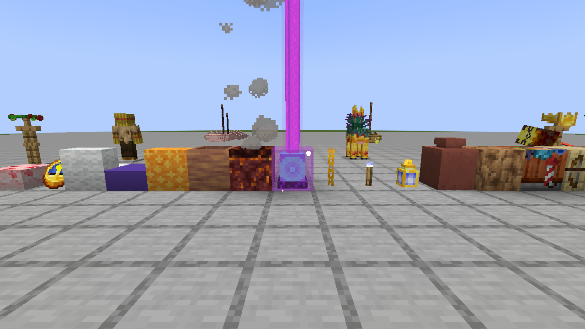
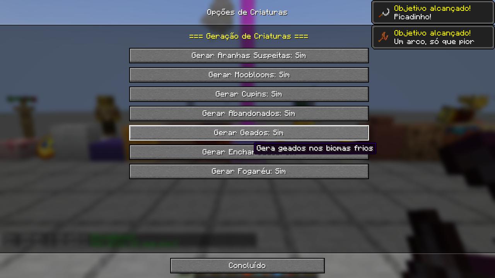
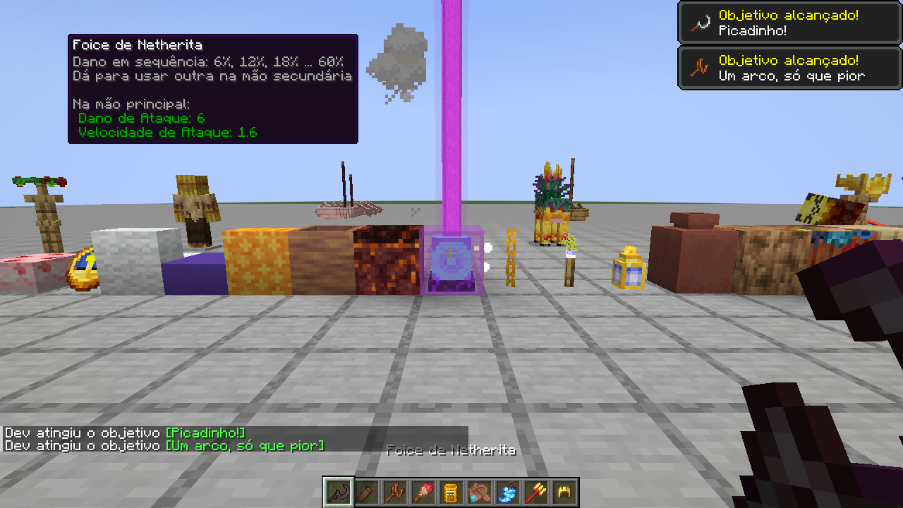
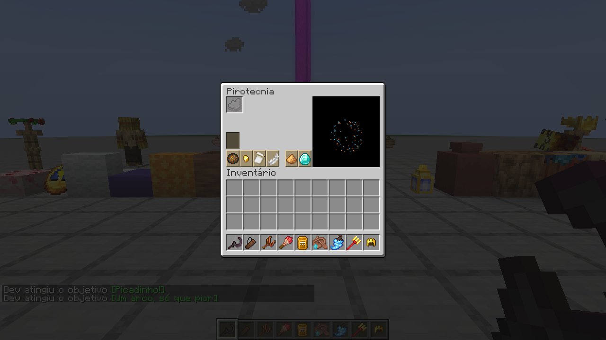

The first NeoForge 1.21.1 build of [Nekoma's Fixed](https://github.com/GreenJAB/nekomas-fixed) by Green_Jab and team: upstream 0.5.5, with a full Brazilian Portuguese translation.

This is an unofficial port. All credit for the mod's ideas, code and art goes to its authors. Please report problems with this build here, not upstream.

### Install

- Minecraft **1.21.1** with **NeoForge 21.1.200** or newer, on both the client and the server.
- No other mods needed. [JEI](https://modrinth.com/mod/jei) is supported if you have it.
- Download `nekomasfixed-neoforge-0.5.5-neoforge.1.jar` below and put it in your `mods` folder.

### What's in it

Everything from upstream 0.5.5 that 1.21.1 can run:

- **The Wildfire**, a Nether fortress boss with two phases, plus its trident, shield and the Heart of the Nether
- **Termites**, termite hives and termite mounds in savannas
- **Big and huge boats** with crews, chests and upgrade templates, plus pillager patrols at sea
- **Kiln, fletching table, quiver** and potion-tipped arrows
- **Colored glints** from prisms, for tools and armor
- **Flower crowns, metal crowns**, the jewel armor trim and goat horn helmets
- **Terracotta decorated pots** with engravings and faces, the soup cauldron, dyed brushes and sulfur lights
- **The Pyrotechnist villager**, with a house in every village type
- **Mobs:** Mooblooms, Derelicts, Drenched, Rimes, Suspicious Spiders and the Target Dummy
- **Blocks:** the baobab wood set, hollow logs, stacked cakes, clams, geysers, the corrupted beacon, the wall clock, extra froglights and four new dye colors with their block sets
- **Mechanics:** smarter foxes and dolphins, food rotting in the Nether, magma that needs Silk Touch, sickles you can dual-wield, turtle armor and more

### Options

Open them from the **Mod Options** button in the pause menu, from the Mods list, or from the mod's tab on the Create New World screen. They're saved per world in `nekomasfixed.json`. Everything uses vanilla buttons, so Cloth Config isn't needed.

### Português do Brasil

The whole mod is translated into Brazilian Portuguese, using Minecraft's own Brazilian wording for vanilla terms: Bote, Tapete, Vidraça, Anfibrilho and so on. The mod's own names are written to sound natural in Portuguese, such as Cupinzeiro, Estilingue and Fogaréu.

### Not in this version

These parts build on vanilla content that 1.21.1 doesn't have:

- spears and the Dismount enchantment
- copper armor and its lightning buff
- pale oak and poplar variants
- eyeblossom crowns
- dyed bundles and harnesses
- cushions
- the baobab shelf

Banners in the four new colors are also left out, because adding dye colors to vanilla's list can crash other mods. [PORTING.md](https://github.com/CoolFreeze23/nekomas-fixed-neoforge/blob/main/PORTING.md) has the details.

### Known behaviour from upstream

- The quiver has no survival recipe yet.
- Big and huge mangrove and baobab boats can't be crafted.
- Breaking a big boat that carries a chest drops three chests.
